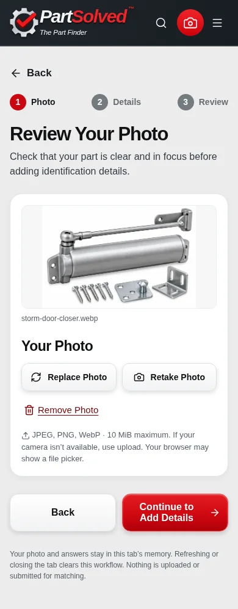
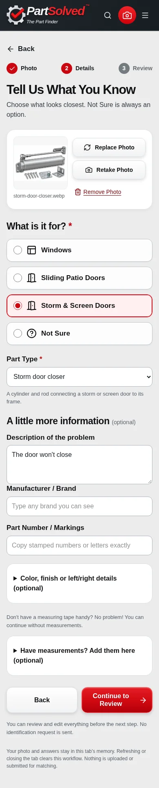
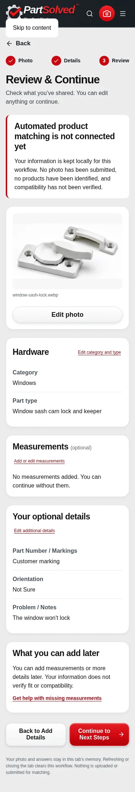

# Mobile photo Finder UX

Branch: `feat/mobile-finder-ux`, stacked on the unmerged catalog foundation branch/PR #14. This keeps the catalog available for regression testing and avoids duplicating its changes in this focused review. No existing PR was merged or modified.

## Customer experience

Photo → **Tell Us What You Know** → **Review & Continue** → existing useful next-step guidance.

The form offers Windows, Sliding Patio Doors, Storm & Screen Doors and Not Sure. Windows combines the existing window lock/operator and balance choices; patio and storm/screen choices separate the previously overlapping door groups. Other and Not Sure part types remain available. Part numbers, brand and problem description are optional; color/orientation and measurements are expandable. Step 2 uses a compact photo card with the existing replace, retake and remove actions.

The native disclosure says **Have measurements? Add them here (optional)**. The reassurance outside it makes clear a tape measure is not needed. Detailed provisional prompts, units, Unknown choices and guidance appear only when expanded. Review shows entered/explicitly unknown measurements, rather than listing each skipped prompt as missing. Empty fields remain valid; malformed optional entered values can be cleared or marked Unknown. Review's measurement edit link opens and focuses the correct section.

## Data and integration boundaries

- `HardwareCategory`, all legacy URLs, ten part-type IDs, category definitions, catalog families and database relationships are unchanged.
- `finderCategory` and per-group part-choice history are optional **browser-memory presentation metadata** on the existing draft. Older drafts without those fields derive the friendly group from their selected type. Legacy request schema version 1 still emits the original category and part IDs, with missing measurements represented honestly as null/missing.
- Switching a customer group restores that group's last part choice. Existing per-type measurements and manual details remain in the same provider. Guided/assisted/AI acceptance clears only the stale presentation-group override so the chosen family displays in the correct new group; it does not clear manual details or measurement history.
- `measurementGuidance()` is a small future-facing adapter over existing provisional prompt IDs. It returns instructions, existing illustrated guide links, inches/mm and Unknown support; it returns no measurements, compatibility decision or match. Unknown prompt requests return null. No catalog-driven matching service is simulated or connected.
- Photo selection/validation inputs, capture attribute, file-picker click handlers, local object URLs and cleanup remain in the existing components. No server upload, persistence, third-party photo transfer or AI request is added. Continuing without AI remains supported. Existing truthful matching/privacy disclosures remain.
- No dependency, Supabase migration, shared resource, supplier integration, domain, authentication or environment change is included.

## Deployment hold

`vercel.json` disables Git deployments **only for `feat/mobile-finder-ux`**, using Vercel's documented `git.deploymentEnabled` branch map. Other branches retain their default behavior. The remote branch is created directly at the guarded commit; no unguarded intermediate feature push is used. No Preview or Production deployment is requested for this work. Obtain owner approval before changing the branch hold, deploying or merging.

## Verification

Local production build, ESLint and TypeScript validation passed. Existing catalog unit/parser tests (seven) and the AI server contract test command passed without real AI calls.

The relevant browser regression suite passed **90 tests with two intentional skips**. It covered photo inputs, validation, cancellation, replacement/removal/recovery, Guided Finder and assistance, all ten existing photographs, intake/measurements, catalog rehearsal/security gates and Guides/video. The skips are mobile-profile repeats already covered by the desktop profile's multi-width sweeps.

After making the Step 2 photo card compact, the production build and quality checks passed again, and **all 20 targeted desktop/mobile checks passed**. These include every legacy type/category mapping, completing without measurements, Unknown selections, invalid optional values, unit conversion, history/back navigation, measurement edit links and native file-picker controls. A final two-profile regression also passed after ensuring that clearing an invalid optional measurement or choosing Unknown keeps the disclosure open.

The Facebook check uses touch-enabled Chromium with an Android/Facebook in-app-browser user agent. It checks the same local photo/details/review flow and overflow at 320, 375, 390, 430, 768 and 1280px. **It is not a physical Android camera or actual Facebook WebView test.** File-chooser events and selected fixture images verify the application capture path; device camera/permissions and actual Facebook integration require manual confirmation.

Reproduce with the project's installed dependencies:

```sh
npm run lint
npm run typecheck
npm run build -- --webpack
npm run test:catalog
npm run test:ai
PLAYWRIGHT_CHROMIUM_EXECUTABLE=/usr/bin/chromium npm run test:e2e -- --config=playwright.finder.config.ts --workers=2 tests/mobile-finder.spec.ts tests/intake.spec.ts tests/homepage.spec.ts tests/assistance.spec.ts tests/ai-photo-assist.spec.ts tests/catalog.spec.ts tests/family-photographs.spec.ts tests/video-player.spec.ts
```

No secrets or Supabase connection are needed for these UI/contract checks. Omit the browser executable override when using Playwright's own installed Chromium.

## Manual Android/Facebook check before release

1. After an approved Preview is available, open it inside Facebook's Android browser.
2. Take a photo; repeat using the gallery. Cancel one picker and confirm the old photo remains.
3. Preview, replace and retake the photo, then continue to Tell Us What You Know.
4. Try all four customer groups, select a part type or Not Sure, and optionally describe the problem. Leave the measurements section closed.
5. Continue to Review & Continue and the existing Next Steps. Confirm no measurement is required and no product match is claimed.
6. Go Back, edit details, remove/re-add the photo and check that answers remain. Expand measurements, enter a known value or Unknown, review it and use Add or edit measurements to return.
7. Refresh once to confirm the existing clear recovery notice; tab-memory retention is not permanent saving.

## Mobile screenshots

Captured from the actual local production build using approved local hardware images and synthetic customer text. They are documentation artifacts, not customer uploads or live product recommendations.

### Photo



### Tell Us What You Know



### Review & Continue without measurements


